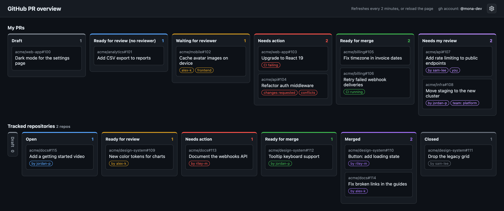

# GitHub PR overview

A local web page that shows your GitHub pull requests as a board and sends a macOS notification when one needs you. It runs on your machine with your own `gh` login and is served on `127.0.0.1` only.



## Contents

- [Install](#install)
- [The board](#the-board)
- [Settings](#settings)
  - [Sections and rules](#sections-and-rules)
  - [Tracked repositories](#tracked-repositories)
  - [Tracked PRs](#tracked-prs)
- [Updates](#updates)
- [Command line](#command-line)
- [Manual setup](#manual-setup)
- [Files](#files)

## Install

On a Mac with [Homebrew](https://brew.sh):

```bash
curl -fsSL https://raw.githubusercontent.com/felipe-promineo/github-pr-overview/main/install.sh | bash
```

Or run `./install.sh` from a clone. The installer:

1. installs what's missing: `gh`, `terminal-notifier`, `git` and Python 3.8+
2. runs `gh auth login` if needed
3. clones the app into `~/Repositories/github-pr-overview`, or updates an existing clone
4. picks a port: the saved one (8765 at first), or the next free one if that's in use
5. adds a login item, so the board runs now, starts at login and restarts if it stops
6. adds the `gh pr-overview` (terminal list) and `gh pr-overview-web` (opens the board) aliases
7. opens the board

| Option | Effect |
|---|---|
| `--dir PATH` | clone somewhere else |
| `--port PORT` | use this port; stops if it's in use |
| `--no-browser` | don't open the board at the end |
| `--uninstall` | remove the login item and aliases (keeps the clone and settings) |

**Update** from the board (see [Updates](#updates)) or by running the installer again. If an org's repositories are missing, it probably uses SSO: run `gh auth refresh` and authorize the token for it at https://github.com/settings/tokens.

## The board

The **My PRs** row has these columns by default:

| Column | Shows |
|---|---|
| Draft | your draft PRs |
| Ready for review (no reviewer) | your PRs with no reviewer requested |
| Waiting for reviewer | your PRs with reviewers requested, listing them |
| Needs action | changes requested, CI failing or merge conflicts |
| Ready for merge | approved (tagged "CI running" while checks run) |
| Needs my review | others' PRs where you or your team is a requested reviewer |

The board refreshes every 2 minutes. A PR that newly lands in **Needs action**, **Ready for merge** or **Needs my review** plays a sound and shows a notification; clicking it opens the PR. Click a column's title to collapse or expand it; the browser remembers the choice.

## Settings

The cog button opens the settings page:

- **Board**: collapse empty columns, refresh interval (or off)
- **Updates**: the running version, auto-update on or off, and **Check now**
- **Start at login**: add or remove the login item (the same one the installer sets up). Switching restarts the board and the page follows it; turning it off keeps the board running until you log out
- **Server**: the port; after saving, the board restarts there and the page follows (a port in use is refused)
- **Notifications**: on or off, and the sound
- **Sections**, **Rules**, **Tracked repositories**, **Tracked PRs**: see below

Leaving the page with unsaved changes asks whether to save first. **Reset to defaults** restores everything.

### Sections and rules

Each column has a title, color, priority, notify switch, [GitHub search query](https://docs.github.com/en/search-github/searching-on-github/searching-issues-and-pull-requests) and an optional rule; the arrows set its position. A column shows the PRs its query finds that match its rule.

A rule is a named set of conditions that matches when **all** of them hold (or **any**, if set). A rule without conditions matches every PR, and several columns can share one.

| Condition | Values | Checks |
|---|---|---|
| State | `open` / `merged` / `closed` | open, merged, or closed without merging |
| Draft | `yes` / `no` | marked as a draft |
| Approved | `yes` / `no` | GitHub's review decision is Approved |
| Changes requested | `yes` / `no` | a reviewer requested changes and wasn't asked to review again |
| CI | `passing` / `failing` / `pending` / `none` | checks on the latest commit |
| Merge conflicts | `yes` / `no` | can't merge cleanly (`no` while GitHub is checking) |
| Reviewers requested | `yes` / `no` | someone or a team is asked to review |
| Review requested from me | `yes` / `no` | you are asked directly (team requests don't count) |
| Author is me | `yes` / `no` | you opened the PR |
| Matches rule / Doesn't match rule | a rule | builds on another rule (loops are dropped on save) |

With **Show each PR only in one section** on (the default), a PR matching several columns only shows in the one with the lowest priority. Use the query for what GitHub search can express, and rules for the rest, such as merge conflicts or "any of" combinations.

### Tracked repositories

A second row can show the PRs of repositories you pick, in any state. The picker lists every repository the `gh` account can see, grouped into personal public, personal private, each org, and collaborations. Filter it, check the ones to track, and use **Reload list** after joining an org.

Each repository contributes its most recently updated PRs (20 by default). They go into shared sections that work like the ones above, without a query: Merged, Closed, Draft, Needs action, Ready for merge, Ready for review and Open. **Hide PRs that already show in the My PRs row** is on by default. A repository that fails to load shows an error; the others still load.

### Tracked PRs

To follow single PRs you aren't part of, in repositories you don't track, paste them under **Tracked PRs**, one per line, as a link (`https://github.com/owner/repo/pull/123`) or as `owner/repo#123`. Lines that are neither are dropped on save. They get their own row on the board, in any state, sorted into the same sections as tracked repositories. A PR already shown in the tracked repositories row isn't repeated, nor one in My PRs while **Hide PRs that already show in the My PRs row** is on. A PR that fails to load (wrong number, or a repository the `gh` account can't see) shows an error; the others still load.

## Updates

The banner shows the commit the board runs, linked to it on GitHub. The board runs `git fetch` in the background when it starts and then once an hour (never on page refreshes); when its branch has new commits, a green arrow appears next to the commit. Click it to fast-forward the clone and restart the board; open pages reload on their own.

Turn on **Install updates automatically** in Settings → Updates to do that without clicking. Updates only fast-forward, so local changes or commits that conflict stop them and the error shows in the settings. A copy that isn't a git clone shows no version and doesn't update.

## Command line

```bash
python3 github-pr-overview.py [--no-browser] [--show-port] [--set-port PORT]
```

| Option | Effect |
|---|---|
| (none) | serve the board and open it |
| `--no-browser` | serve without opening it |
| `--show-port` | print the port, then exit |
| `--set-port PORT` | save a port (used on the next start), then exit |

`github-pr-overview.sh` prints your PRs in the terminal.

## Manual setup

Without the installer you need macOS, Python 3.8+, the [GitHub CLI](https://cli.github.com/) (logged in with `gh auth login`) and `brew install terminal-notifier`. Then run `python3 github-pr-overview.py`.

To start it at login:

1. Copy `github-pr-overview.plist` to `~/Library/LaunchAgents/`.
2. Replace `/path/to/github-pr-overview` with your clone's path and check the `python3` path (`which python3`).
3. Load it with `launchctl bootstrap gui/$(id -u) ~/Library/LaunchAgents/github-pr-overview.plist`.

After pulling changes, restart it with `launchctl kickstart -k gui/$(id -u)/github-pr-overview`.

## Files

| Path | Contents |
|---|---|
| `~/.config/github-pr-overview/settings.json` | settings |
| `~/.config/github-pr-overview/repositories.json` | cached repository list |
| `~/Library/LaunchAgents/github-pr-overview.plist` | login item |
| `/tmp/github-pr-overview.log` | server log |
